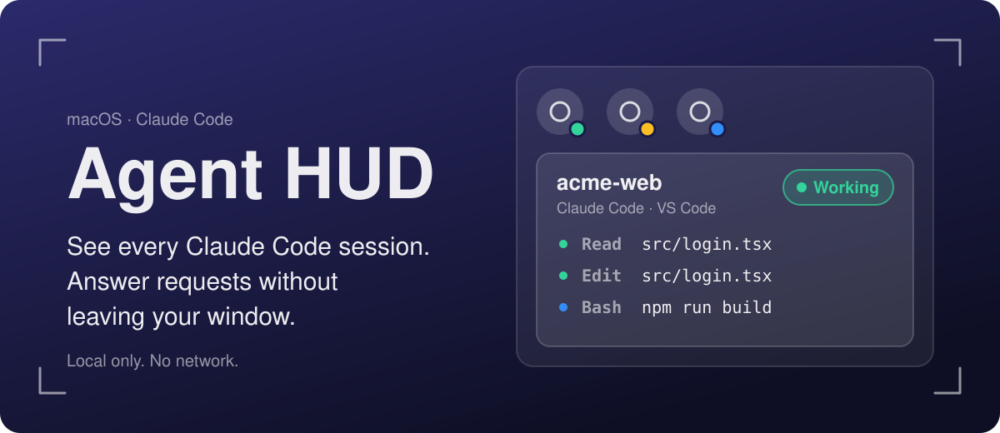
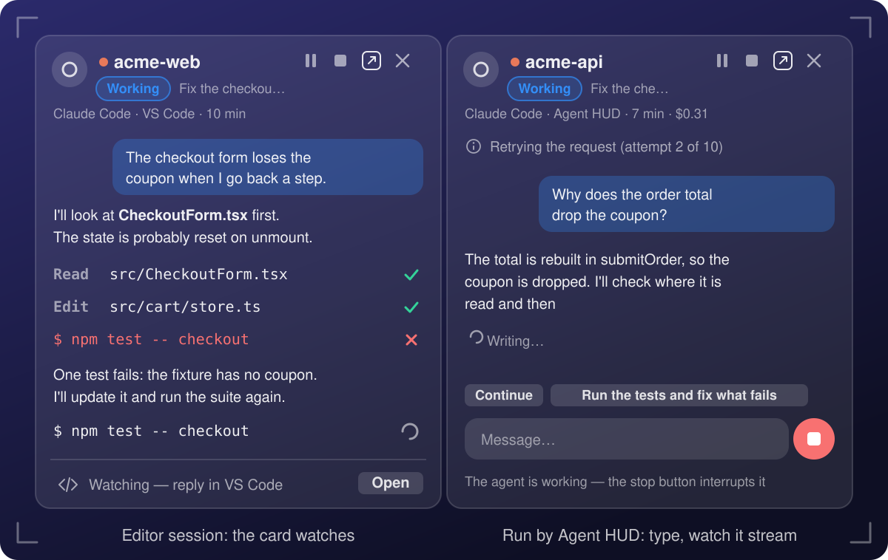
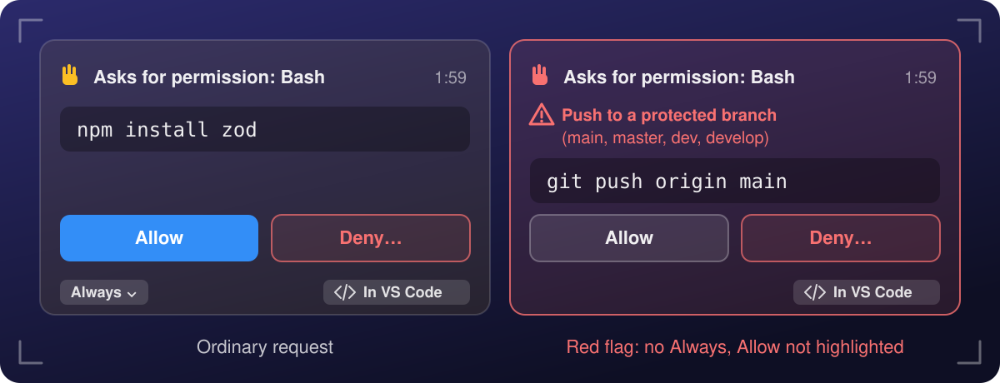
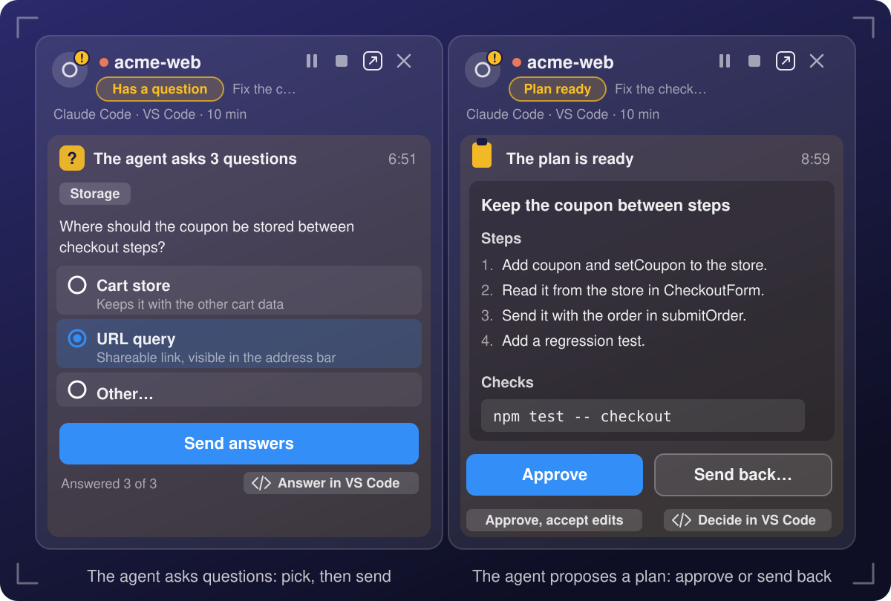
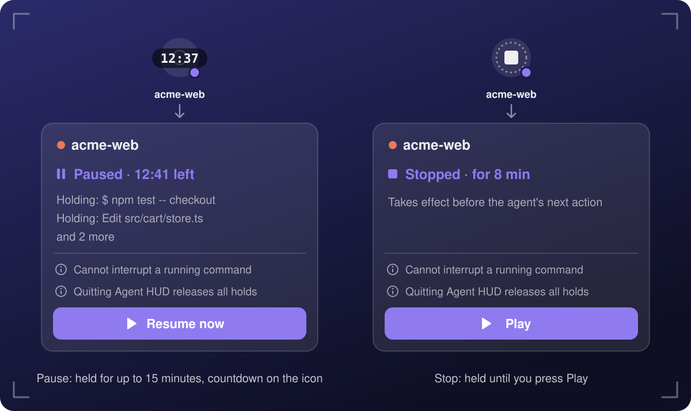
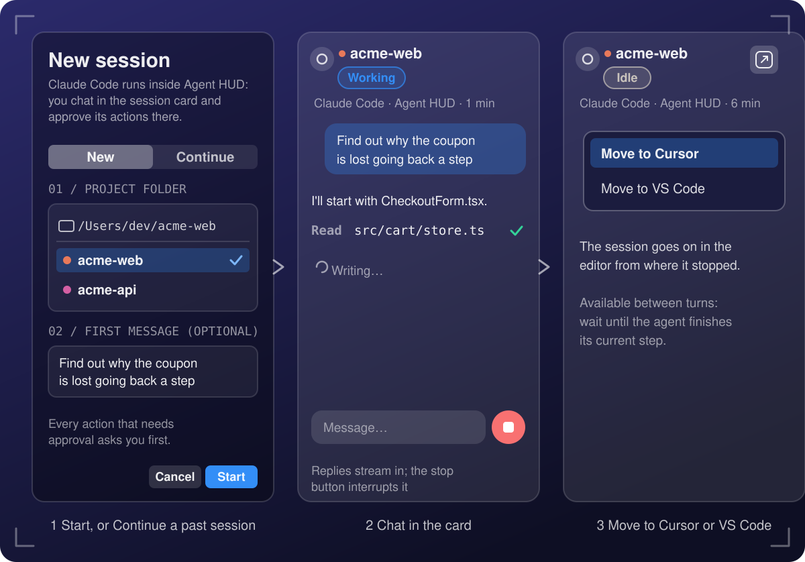
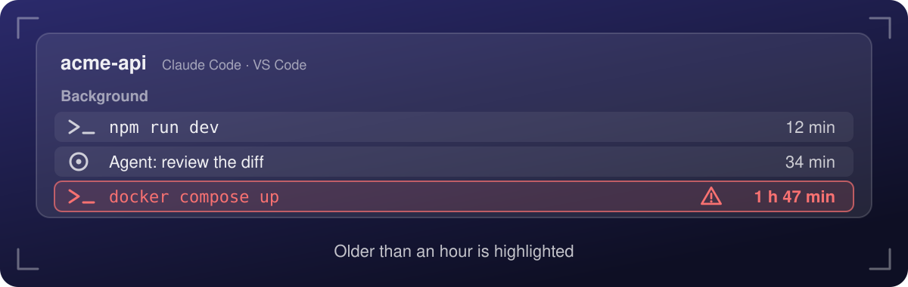
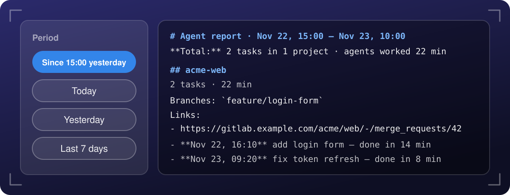
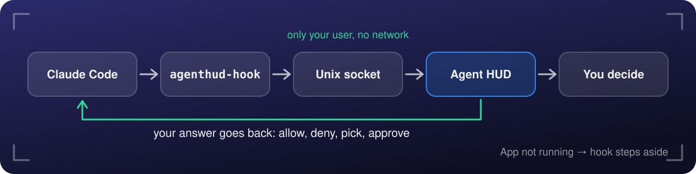
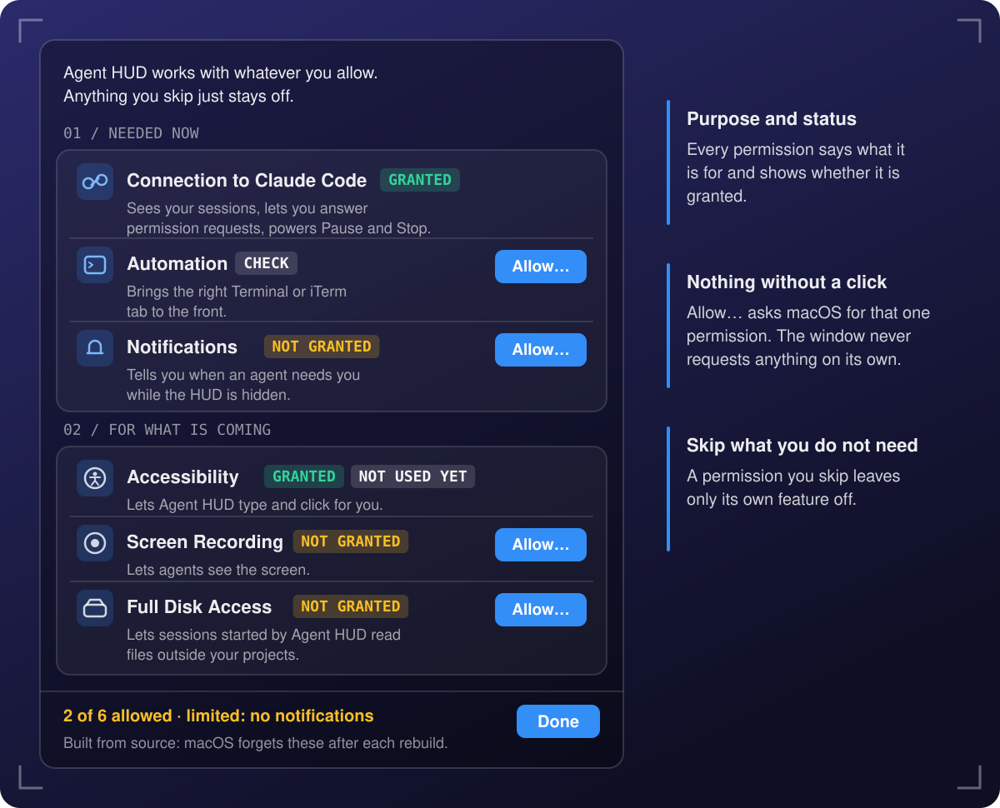

# Agent HUD

<p align="center">
  
</p>

Based on [AgentHUD](https://github.com/vladilenm/agent-hud) by Vladilen Minin (MIT).

A small macOS app for Claude Code. Every session becomes a small icon on your desktop. Click it to see the
conversation, answer what the agent asks, pause it, or start a new session without opening a terminal. The
pictures here are drawings of the interface.

## Sessions on your desktop

Each Claude Code session is one small transparent icon with the project name under it. A dot shows the state, a
badge says the agent needs you, and a red mark says a background task looks stuck. Drag an icon anywhere and it
stays there. Click it to open a card of fixed size next to it; click anywhere outside to close the card.

## The card is the conversation

The card shows the session as a chat: your messages, the agent's replies with Markdown, and every tool call with
its status. Sessions that run in an editor or a terminal are watch-only: the footer says "Watching — reply in
VS Code" and a button takes you there. Sessions run by Agent HUD have a message field, stream the reply as it is
written, and can be interrupted.

<p align="center">
  
</p>

## Answer from the card

When the agent needs you, the card shows the request instead of making you hunt for the right window.

- **Permissions:** Allow, Deny… with a reason, or Always for a rule. Or answer in the editor instead.
- **Red flags:** dangerous commands are shown in red with the reason and offer no Always. Out of the box:
  pushing to `main` / `master` / `dev` / `develop`, `--force`, creating or merging a merge or pull request,
  `rm -rf`, database migrations. The rules live in a JSON file you can edit.
- **Questions:** the agent's multiple-choice questions, one or several, with an Other… field. Send all answers at
  once.
- **Plans:** read the plan, then Approve, "Approve, accept edits", or Send back… with feedback.

<p align="center">
  
</p>

<p align="center">
  
</p>

## Pause and Stop

Pause holds the agent before its next action for at most 15 minutes; the icon blurs and shows a countdown. Stop
holds it until you press Play. Both continue from the same place. Hover the icon for what is held and for the
limits: a command that is already running cannot be interrupted, and quitting Agent HUD releases all holds.

<p align="center">
  
</p>

## Sessions run by Agent HUD

"New session…" starts Claude Code inside the app. Pick a project folder, write a first message if you like, and
chat in the card. Every action that needs approval asks you first. "Continue a session…" lists past sessions to
pick up where they stopped. "Move to Cursor" or "Move to VS Code" hands a running session over to the editor.

<p align="center">
  
</p>

## Command bar

Press Control-Option-Space in any app and a small bar appears. Type what you want and press Return: it goes to
the Assistant, one long-lived session run by Agent HUD for general requests, and its card opens with the reply.
The chip on the left sends the command to another session run by Agent HUD instead, or starts a new one in a
project. If the target is still working, Return queues the message and Command-Return interrupts first. The
hotkey can be changed or switched off in the settings; the list of recent commands stays on your Mac and can be
cleared or switched off.

## Routines

A routine is a saved request that Agent HUD starts by itself: every day at a set time on the days you choose,
every few hours, or only when you press "Run now". Each run is a new session with its own icon and card.
Routines run only while the app is open and the Mac is awake; a run missed within the last 12 hours happens
once when the app is back. Nothing is approved in advance: a run that needs your approval asks like any
session and waits, and you get a notification. The list lives in a `routines.json` file you can also edit by
hand, and a log keeps the outcome of each run without the text of the request or the reply.

## Voice

Voice is off until you switch it on. Then hold the command bar hotkey and speak: the bar shows what it hears,
and when you let go the text is sent like a typed command, after a moment in which Escape cancels. The
Assistant's reply is read out in a short form; the full text is in its card. English and Russian are available.

The reply is spoken with the best voice installed for the language. In the settings you can pick another one,
listen to it with Preview and set the speed. More natural voices can be downloaded in System Settings under
Spoken Content; a button in the settings takes you there. A question asked by voice gets a short conversational
answer in the language you used.

The microphone is on only while you hold the key. Recognition runs on your Mac; if that is not available for a
language, the app says so and uses Apple's servers only if you allow it in the settings. Voice sends messages
and nothing else: approving a request always takes a click.

## Agents can look at the screen

With your consent an agent can list the open windows, take a screenshot of the screen or of one window, and read
a window's text. It is read-only: nothing is clicked or typed. Each look asks you in the card first, or once per
session if you choose that mode; "Off" refuses every look. Password managers, Keychain Access, Passwords and
System Settings are never shown, also not inside a full-screen picture, and you can add more apps to that list.
The session icon shows an eye while an agent is looking, and the log keeps what was looked at, not the picture.

Sessions run by Agent HUD get these tools by themselves. For sessions in an editor or terminal, connect them in
the setup window.

## Agents can act in apps

This is off until you switch it on. Then an agent can press a button or link it found in a window, click at a
point, type text, press a key combination, scroll, bring a window forward and open an app. Nothing else: no
dragging, no file operations.

Every action asks you first and the card shows exactly what will happen: the app and window, the element, or
the whole text to be typed. In the "Per app" mode you can allow one app for one session. Some things are
refused outright: a caller the app cannot match to a session, a paused or stopped session, password managers,
Keychain Access, System Settings, the login window, and typing while a password field has the focus. Key
combinations that close or delete things, and any command-key combination in a terminal or Finder, always ask.

Control-Option-Command-Period switches all of this off at once, refuses what is waiting and clears what was
allowed. It needs the Accessibility permission.

## Background tasks

Every background shell and background agent of a session, with its age. Anything older than an hour is
highlighted, so a forgotten dev server or a stuck agent is easy to spot.

<p align="center">
  
</p>

## Report for a period

One click gives a Markdown report for any time range, grouped by project, with the branches and merge request
links that appeared in commands.

<p align="center">
  
</p>

## How it works

Claude Code calls a small hook, `agenthud-hook`. The hook talks to the app over a Unix socket that only your user
can open, and your answer goes back the same way. If the app is not running, the hook steps aside and Claude Code
behaves as if it was never installed.

<p align="center">
  
</p>

Privacy: the app itself has no network code. To show the chat it reads the session transcript from your disk.
Sessions that Agent HUD starts are ordinary Claude Code processes that use your own login. A screenshot or window
text that you allow an agent to take is sent to the model, like any other tool result. The activity log is a
local file you can switch off in the settings.

Limits: requests reach the app through hooks, so sessions started before you connected do not report. Start a new
one. Sessions run by Agent HUD need the `claude` command-line tool installed.

## Requirements

- macOS 15 or later
- Swift 6 toolchain (Xcode or Command Line Tools)
- Claude Code in the terminal, VS Code, Cursor or another VS Code based editor
- The `claude` command-line tool, to run sessions from Agent HUD

## Install

```sh
git clone https://github.com/komilovsg/agent-hud.git
cd agent-hud
scripts/build-app.sh --install
open ~/Applications/AgentHUD.app
```

This builds the app, puts it in `~/Applications` and links the hook to `~/.local/bin/agenthud-hook`.

The setup window opens on first launch. It lists the connection to Claude Code and the macOS permissions, each
with what it is for and its status. Nothing is requested until you click, and a permission you skip only leaves
its own feature off.

<p align="center">
  
</p>

The connection shows exactly what it will add to `~/.claude/settings.json`, keeps your existing hooks in place
and in order, and saves a copy of the file as `settings.json.agenthud-backup-<date>` before writing.
Disconnecting removes only its own entries.

The app is built from source and signed ad hoc, so macOS forgets its permissions after each rebuild. Open the
setup window again and allow them once more.

## Red flag rules

The rules are in `~/Library/Application Support/AgentHUD/red-flags.json`. The control panel has a button that
opens the file. Changes apply on the next request, no restart needed.

```json
{
  "version": 1,
  "rules": [
    { "id": "prod-db", "title": "Production database", "pattern": "db\\.example\\.com" }
  ]
}
```

`pattern` is a case-insensitive regular expression searched in the whole Bash command. A rule with a broken
pattern is skipped and reported in the control panel. If the file cannot be read at all, the built-in rules are
used.

A red flag is a warning, not a block: you can still allow the command once.

What the default rules cannot see: a plain `git push` while you are on a protected branch (the command does not
name the branch), and connection strings hidden in environment variables.

## Report from the command line

```sh
~/Applications/AgentHUD.app/Contents/MacOS/AgentHUD --report "2026-11-22 15:00"
~/Applications/AgentHUD.app/Contents/MacOS/AgentHUD --report "2026-11-22 15:00" "2026-11-23 10:00"
```

The second date is optional and defaults to now.

## Development

```sh
swift build
swift run AgentHudCoreTests
swift run AgentHud --render /tmp/hud-render
```

Tests are an executable target, so they run without Xcode. The `--render <dir>` flag draws the interface to PNG
files with sample data and exits. The app icon is drawn by `scripts/make-icon.swift`.

## License

MIT. See [LICENSE](LICENSE). Fonts in `Resources/Fonts` are under the SIL Open Font License, with their license
texts next to them.
